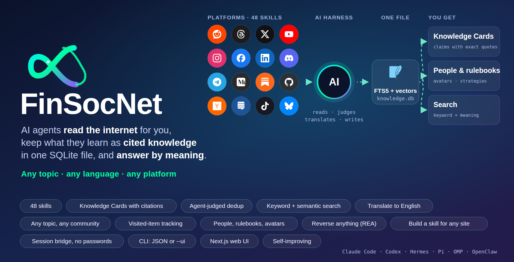
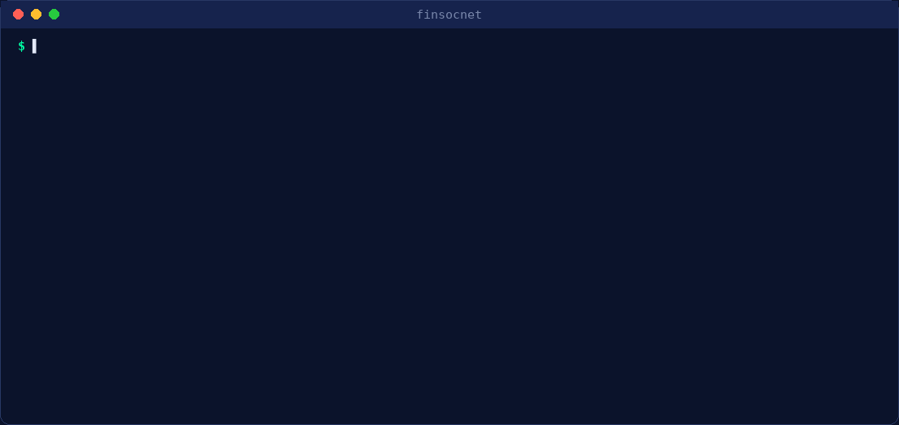
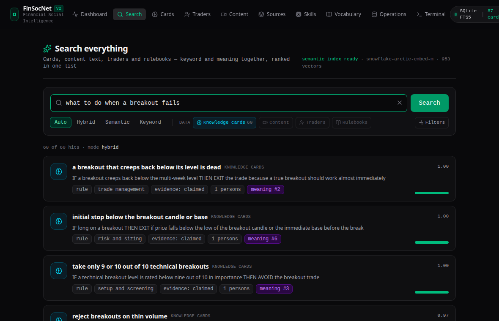

<div align="center">



# FinSocNet

**An agent-operated knowledge network.** Your AI harness explores people, communities, channels and threads on any topic, in any language, on any platform; turns what it reads into cited **Knowledge Cards**; keeps everything in **one SQLite file**; and answers by keyword *and* meaning.

[Docs](docs/README.md) · [Getting started](docs/getting-started.md) · [CLI](docs/cli.md) · [Search](docs/search.md) · [Exploring](docs/exploring.md) · [Web UI](docs/web-ui.md) · [Specs](specs/README.md)



</div>

## Why it exists

Knowledge about markets (and anything else) is scattered across videos, podcasts, threads, chats, newsletters, forums, papers and code, in many languages, written by people who repeat, refine and contradict each other. FinSocNet gives an AI harness (Claude Code, Codex, Hermes, Pi, OMP, OpenClaw) the tools to **find** those sources, **capture** them, **distil** them into atomic claims with exact quotes, **merge** duplicates with judgment, and **serve** cited answers, per-person rulebooks, consensus and contradictions.

**You are the only model in it.** Scripts fetch, store, validate, search and score; the agent reads, judges, translates and writes. No LLM API is called from a script. Skills follow the open [Agent Skills](https://agentskills.io) format.

## What you get

| | |
|---|---|
| **Knowledge Cards** | one atomic statement (`rule`, `setup`, `observation`, `mechanism`, `definition`, `metric`, `practice`) in a fixed grammar such as `IF breakout position AND 3-5 days since entry THEN EXIT_PARTIAL 1/4-1/3 of position`, controlled vocabulary, citations with exact quote, segment and speaker |
| **Agent-judged deduplication** | `same / refines / related / contradicts / new`, logged with a rationale, atomic, undoable |
| **Search by keyword and meaning** | BM25 plus local embeddings (default model chosen from the [MTEB leaderboard](https://huggingface.co/spaces/mteb/leaderboard)) fused in the same SQLite file; one query across cards, content text, people and rulebooks with filters and ranking → [Search](docs/search.md) |
| **Everything in English for search** | the agent detects languages and translates; questions are translated into a Query Card before embedding → [Search → Languages](docs/search.md#languages) (skill `translator`) |
| **Explore any topic** | no topic limit in any explorer; knowledge gaps drive exploration; a discovery recipe per platform; **visited-item tracking** so nothing is looked at twice → [Exploring](docs/exploring.md) |
| **48 skills, 30+ platforms** | YouTube, podcasts, X, Reddit, Bluesky, Threads, Instagram, Facebook, LinkedIn, Discord, Telegram, Medium, Substack, RSS, forums, Stack Exchange, Hacker News, TradingView, Seeking Alpha, StockTwits, GitHub, papers, SEC filings, books, web and documents → [Skills](docs/skills.md) |
| **Add a skill for any site** | give a URL; the agent probes it (robots.txt, feeds, APIs, bot walls), asks you what it needs, writes a recipe, tests it live and scaffolds the skill → `platform-skill-builder` |
| **People, not channels** | canonical persons across platforms, roles per citation, rulebooks per person, **avatars and images stored as files** → [People](docs/persons.md) |
| **Reverse anything** | binaries, packaged apps, SQLite files, captures, model files become readable content through [REA](https://github.com/morluto/rea) (static, read-only) → [Reverse anything](docs/reverse-anything.md) |
| **CLI first** | one JSON envelope per command; add `--ui` for a terminal view; no HTTP API in Python → [CLI](docs/cli.md) |
| **Web UI** | Next.js app that calls the CLI: search with semantic mode, data-type chips and filters, cards, traders with avatars, content, operations → [Web UI](docs/web-ui.md) |
| **Remote-first sessions** | log in on your machine, ship an encrypted session bundle, one agent Chrome on the server; no passwords or cookies in `.env` → [Sessions](docs/sessions.md) |
| **Self-improving** | failed searches become gaps; lessons become reviewed changes on git branches with evaluation results; the self-improver never merges → [Operations](docs/operations.md) |

<div align="center">

</div>

## How it works

```
platform skills ──fetch──► contents + segments ──► agent writes Knowledge Cards ──► validate ──► dedup (agent decides) ──► commit
 (youtube, reddit, x,       (data/knowledge.db:      (claim grammar, controlled       kb card      same / refines / related       atomic,
  threads, forums, any       SQLite + FTS5 +          vocabulary, exact quotes,        validate     / contradicts / new            logged
  site you add, files)       embeddings)              English)                                                                      │
                                                                                                                                   ▼
 question (any language) ─► translate ─► Query Card ─► embed ─► kb search (BM25 + vectors) ─► cited answer ─► weak? ─► gap ─► explore
```

Read [Concepts](docs/concepts.md) for the model, [`specs/`](specs/README.md) for the design and decisions (ADRs).

## Quick start

```bash
git clone <this repository> finsocnet && cd finsocnet && ./install.sh          # or: uv sync && uv run finsocnet kb init
uv run finsocnet kb doctor                                                     # "ok": true
uv run finsocnet install all                                                   # slash commands + skill links for your harnesses

uv run finsocnet explore add "pairs trading"                                   # any topic, URL, @handle or query
# in your harness:  /finsocnet:explore-step     /finsocnet:search should I hold overnight?     /finsocnet:strategy <person>

uv run finsocnet kb embed sync                                                 # make cards searchable by meaning
uv run finsocnet search "how to size a position after a losing streak" --ui    # terminal view; without --ui: JSON
make web-install && make web-build && make web-start                           # web UI on :3000
```

Needs `uv`, Python ≥ 3.11, SQLite ≥ 3.38 (about 0.5 GB for the embedding model). Remote hosts and sessions: [Sessions](docs/sessions.md). Everything else: [Getting started](docs/getting-started.md).

## Documentation

| | |
|---|---|
| [docs/](docs/README.md) | the platform documentation: getting started, concepts, CLI, search, exploring, people, skills, sessions, reverse anything, web UI, configuration, operations, troubleshooting |
| [specs/](specs/README.md) | design and decisions: database, Knowledge Cards, pipelines, sessions, platform skills, evaluation, harness integration, semantic search, visited items, images, REA, skill builder, UI; the implementation checklist and what still waits for you |
| [AGENTS.md](AGENTS.md) | the operating guide and hard rules for agents working in this repository |

## Status

Implemented and tested offline (`uv run pytest`, 237 tests including a real headless Chromium). What was checked against real sites, and what still needs your accounts or machine (session-gated platforms, real harness installs, independent review of the evaluation sets), is listed in [`specs/09-checklist.md`](specs/09-checklist.md) and in each skill's `references/platform_notes.md`.

## Responsible use

Reading Discord, Facebook, LinkedIn or Instagram by automating a user account can violate their terms and get the account banned; use a secondary account, keep the strict budgets, and read the notes in [`specs/README.md`](specs/README.md) §9. Respect `robots.txt`: the site probe reports it and refuses to build a scraper for sites that disallow crawlers. Downloading copyrighted books may be illegal where you live. Platform logos in the cover image belong to their owners and are shown only to name the platforms the skills read. Nothing here is investment advice.
